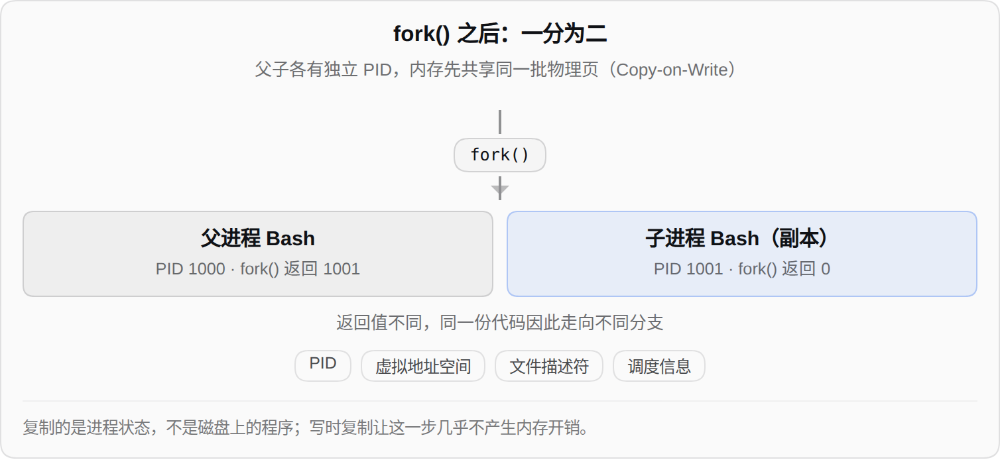
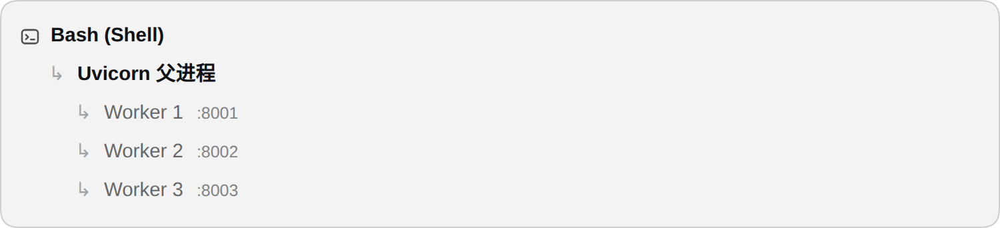
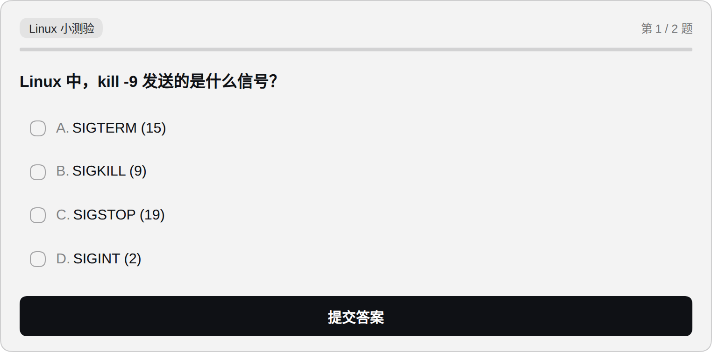
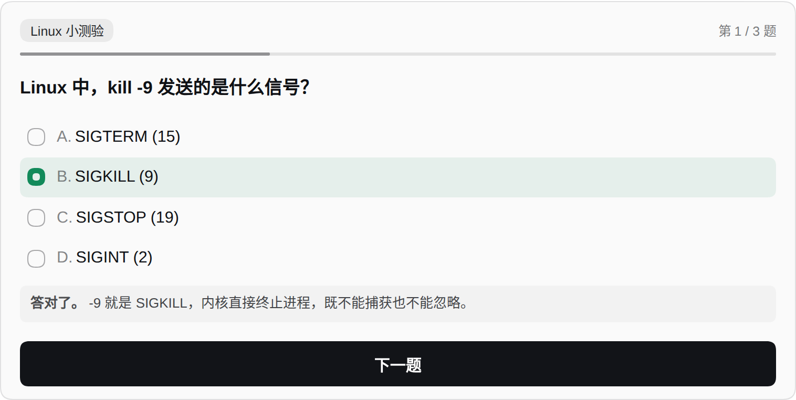
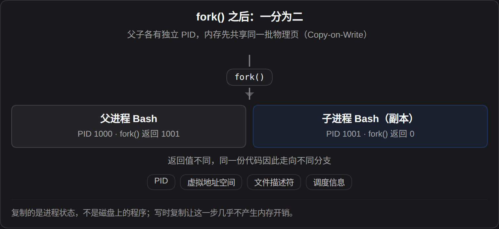

# dsh-chat-figure

简体中文 | [English](README.en.md)


---

在 DSH 对话里画示意图、层级树和选择题。三种代码块会被渲染成真实 HTML：文字是真文字，可选中、可缩放、跟随明暗主题，选择题可以直接点着作答。零依赖，不联网，不调用模型。

## 功能

| 块 | 用途 | 产出 |
| --- | --- | --- |
| `%%figure` | 流程、结构、对比 | 盒子、箭头、注释、标签、图注 |
| `%%tree` | 进程树、目录树、调用层级 | 缩进即层级，父节点加粗、叶子变淡 |
| `%%quiz` | 随堂测验 | 单选、提交判分、解析、进度、成绩页 |

## 效果

| 流程结构图 | 层级树 |
| --- | --- |
|  |  |

| 选择题（一次一题） | 答完立即判分 |
| --- | --- |
|  |  |

<details>
<summary>深色主题</summary>



</details>

## 用法

块的第一行是哨兵，决定渲染成什么；围栏语言写什么都行。

### `%%figure`

````markdown
```figure
%%figure
title: fork() 之后：一分为二
sub: 父子各有独立 PID，内存先共享同一批物理页
arrow: fork()
row
box gray: 父进程 Bash | PID 1000 · fork() 返回 1001
box blue: 子进程 Bash（副本） | PID 1001 · fork() 返回 0
note: 返回值不同，同一份代码因此走向不同分支
pills: Copy-on-Write, PID, 地址空间
foot: 复制的是“进程状态”，不是磁盘上的程序。
```
````

| 行 | 含义 |
| --- | --- |
| `title:` / `sub:` | 居中标题 / 灰色副标题 |
| `arrow: 标签` 或 `arrow` | 竖向箭头，标签可省略 |
| `row` | 开始一行并列盒子，后续 `box` 归入该行 |
| `box [gray\|blue\|green\|amber\|plain] [wide]: 标题 \| 副标题` | 盒子；`wide` 强制整行 |
| `note:` / `pills:` / `foot:` / `gap` | 居中注释 / 胶囊标签 / 底部图注 / 空隙 |

### `%%tree`

````markdown
```tree
%%tree
systemd (PID 1)
  uvicorn.service | PID 1000
    Worker 1 | PID 1001
    Worker 2 | PID 1002
```
````

缩进两格一层；`标题 | 备注` 的备注以灰色小字跟在后面。

### `%%quiz`

````markdown
```quiz
%%quiz
tag: Linux 小测验
q: Linux 中，kill -9 发送的是什么信号？
A. SIGTERM (15)
B. SIGKILL (9)
C. SIGSTOP (19)
D. SIGINT (2)
answer: B
why: -9 就是 SIGKILL，内核直接终止，既不能捕获也不能忽略。
```
````

- 顶部是标签 + `第 n / N 题` + 进度条；
- 单选 → 「提交答案」→ 判分并展开解析 → 「下一题」；
- 最后一题后是成绩页：答对 x/N、逐题回顾、重做、复制结果；
- 加一行 `mode: list` 改为一次显示整卷。

| 关键字 | 含义 |
| --- | --- |
| `q:` / `问题:` | 开始一道新题 |
| `A.` ~ `H.` | 选项 |
| `answer:` / `答案:` | 正确项 |
| `why:` / `解析:` | 判分后展示的解释 |
| `tag:` / `title:` | 卡片顶部标签 / 标题 |

## 工作原理

1. **识别**：读代码块第一行，`%%figure` / `%%tree` / `%%quiz` 决定用哪个渲染器；
2. **解析**：逐行读指令，生成中间结构——空行和 `#` 注释忽略，流式输出中未闭合的块按已有内容先渲染；
3. **渲染**：生成普通 DOM，颜色全部从 `currentColor` 派生，深浅主题共用一套规则；内容变化时原地替换旧节点；
4. **状态**：选择题的选项、当前题号、完成态写入 `localStorage`，键是块内容的哈希，刷新和重渲染都能恢复；
5. **调度**：`MutationObserver` 监听会话 DOM，出现新代码块就处理一次。

## 安装

```bash
# 1. 链进 profile
ln -s /path/to/dsh-chat-figure ~/.dsh/profiles/web/node_modules/dsh-chat-figure

# 2. 在 profile 的 patch 层追加一行
cat >> ~/.dsh/profiles/web/cordis.patch.yml <<'YAML'
- insert:
    - id: chat-figure
      name: 'dsh-chat-figure'
YAML
```

刷新页面即生效，无需重启 `dsh web`。

## 限制

- 仅支持 DSH Web，浏览器需支持 `color-mix()`（Chrome 111+ / Safari 16.2+ / Firefox 113+）；
- 渲染后会隐藏原始代码块，只显示图形；
- 不支持 Mermaid 语法；
- 判分在浏览器本地完成，模型看不到你的作答——用「复制结果」回传，或直接说明错题。

[更新日志](CHANGELOG.md) · [MIT](LICENSE)
